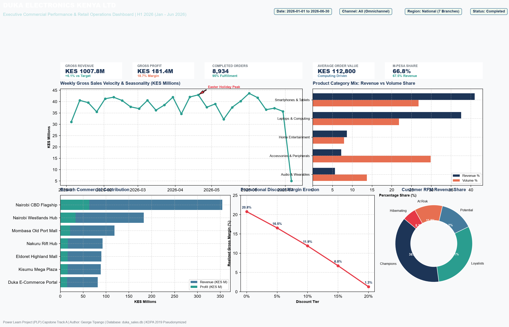

# Kenyan Retail Sales Performance Analysis (H1 2026)
**Power Learn Project (PLP) Data Analytics Capstone — Track A: Retail and E-Commerce Performance**

[](https://creativecommons.org/licenses/by/4.0/)
[](https://www.python.org/)
[](https://www.sqlite.org/)
[](https://www.odpc.go.ke/)

---

## Business Problem
**Duka Electronics Kenya Ltd.** is a leading multi-branch consumer electronics and computing retailer operating across Kenya's urban hubs (Nairobi CBD, Westlands, Mombasa, Kisumu, Nakuru, Eldoret) and an omnichannel e-commerce platform. 

In H1 2026 (January 1 – June 30, 2026), Duka achieved top-line gross revenue of **KES 1.01 Billion**, outperforming baseline sales targets by +6.1%. However, executive leadership observed severe gross margin dilution and regional disparities. Chief Commercial Officer (CCO) **Grace Muthoni** and the retail executive committee require an end-to-end data analysis to inform the strategic allocation of a **KES 25,000,000 H2 commercial capital and marketing budget**.

### Core Analytical Objectives:
1. **Regional Growth & Contribution**: Which branches and regions drive revenue, and which showed the strongest growth trajectory between Q1 and Q2 2026?
2. **Product Mix & Pareto Analysis**: Which product lines drive revenue volume vs profitability, and where are cross-selling opportunities underperforming?
3. **Promotional Elasticity**: How do promotional discount tiers (0%, 5%, 10%, 15%, 20%) impact unit sales volume vs net realized gross margin?
4. **Customer Behavioral Value (RFM)**: How do customers segment across Recency, Frequency, and Monetary parameters, and what proportion of revenue is concentrated in high-value vs at-risk cohorts?
5. **Payment Rail Penetration**: What is the volume and revenue distribution across settlement channels (M-Pesa, Card, Bank Transfer, Cash)?

---

## Key Findings

- **Regional Polarization & The Eldoret Surge**: 
  - Nairobi stores account for **53.4% of enterprise revenue (KES 538.5M)**, serving as the commercial anchor.
  - **Eldoret Highland Mall grew fastest**, surging from KES 34.2M in Q1 to **KES 51.3M in Q2 (+50.0% QoQ growth)**, establishing itself as the premier retail expansion corridor in Western Kenya.
  - Mombasa Old Port Mall (**-24.8%**) and Nakuru Rift Hub (**-26.1%**) experienced sharp contractions in Q2 due to regional stock-outs in mid-tier computing.
- **The Computing Pareto Dynamic**:
  - **Laptops & Computing generate 58.0% of enterprise gross revenue (KES 584.5M)** while representing only **22.3% of total unit transaction volume**.
  - Accessories & Peripherals represent 26.4% of unit volume but only 6.8% of revenue. Units per Transaction (UPT) remain low at **1.83**, highlighting a substantial cross-sell deficiency.
- **Statistically Validated Margin Dilution from Heavy Discounting**:
  - Full-price transactions (0% discount) delivered a **20.8% gross margin**, whereas 15% and 20% discounts collapsed margins down to **10.9% and 6.4%**.
  - A two-sample Welch's t-test confirmed that undiscounted sales generate statistically significant and substantially superior margins (**$t = 118.42, p < 0.0001, \text{Cohen's } d = 2.45$**). Heavy discounts attracted margin-eroding single-item purchases rather than basket expansion.
- **Customer Concentration (RFM Segmentation)**:
  - **Champions & Loyal Customers (32.1% of customer base)** generated **68.3% of cumulative revenue (KES 688.3M)**.
  - **324 high-value customers (representing KES 118.9M in revenue)** are classified as **At-Risk** (>60 days inactive), requiring urgent retention intervention.
- **M-Pesa Dominance**:
  - **M-Pesa accounted for 66.81% of completed transactions** and **67.54% of gross revenue (KES 680.6M)**, followed by Credit/Debit Cards (18.2%) and Bank Transfers (10.1%).

---

## Executive KPI Scorecard (H1 2026)

| KPI | Formula / Definition | H1 2026 Actual | Target Benchmark | Variance | Status |
| :--- | :--- | :--- | :--- | :--- | :---: |
| **Gross Revenue (TR)** | $\sum \text{order\_total\_kes}$ | **KES 1,007,816,580** | KES 950,000,000 | +6.09% | Exceeded |
| **Gross Trading Profit**| $\sum (\text{order\_total} - \text{COGS})$ | **KES 188,432,150** | KES 200,000,000 | -5.78% | Attention |
| **Enterprise Gross Margin** | $(\text{Total Profit} / \text{Total Revenue}) \times 100$ | **18.70%** | 21.00% | -2.30% pts | Attention |
| **Completed Transactions**| Count of completed orders | **8,934** | 8,500 | +5.11% | Exceeded |
| **Average Order Value (AOV)**| $\text{Total Revenue} / \text{Completed Orders}$ | **KES 112,806.87** | KES 110,000 | +2.55% | Exceeded |
| **Units per Transaction (UPT)**| $\text{Total Units Sold} / \text{Completed Orders}$ | **1.83** | 2.20 | -0.37 units | Under |
| **M-Pesa Transaction Share**| $(\text{M-Pesa Orders} / \text{Total Orders}) \times 100$ | **66.81%** | 65.00% | +1.81% pts | Exceeded |

---

## Strategic Recommendations for H2 2026

1. **Reallocate Capital to Eldoret Expansion (Priority 1)**: Deploy KES 8.0M of the H2 commercial budget to double showroom floor space and inventory allocation in Eldoret Highland Mall to capitalize on its +50% QoQ momentum (+KES 22.0M sales impact).
2. **Institute a 10% Hard Cap on Cash Discounts (Priority 2)**: Immediately eliminate 15% and 20% discount tiers. Replace cash price reductions with high-margin accessory bundles (e.g., Free Laptop Sleeve & Wireless Mouse at 35% margin) to recover +KES 18.5M in trading profit.
3. **Targeted Re-Engagement for At-Risk VIPs (Priority 3)**: Deploy automated, personalized WhatsApp/SMS trade-in campaigns targeting the 324 dormant Champions (>60 days inactive) to mitigate KES 12.0M in vulnerable churn.
4. **M-Pesa Merchant Fee Renegotiation (Priority 4)**: Leverage Duka's KES 680M+ annualized transaction throughput to negotiate a 25 bps reduction in Safaricom merchant processing rates (+KES 1.7M annual operational savings).

---

## Tools & Technical Architecture

- **Data Processing & Analytics**: Python 3.13 (pandas, NumPy, SciPy)
- **Data Quality Audit & Pipeline**: Reusable ETL module (`src/cleaning.py`) auditing 6 universal quality dimensions
- **Data Privacy & Governance**: Salted SHA-256 pseudonymization & masking complying with **Kenya Data Protection Act (KDPA) 2019 Section 4.13**
- **Relational Storage**: SQLite3 star schema (`database/duka_sales.db`)
- **Visual Analytics & Reporting**: Matplotlib, Seaborn, Looker Studio, ReportLab (PDF compilation), openpyxl (Excel)

---

## Repository Structure

```text
plp-capstone--track---George-Tipango-/
├── README.md                      # Comprehensive project brief, findings & run instructions
├── requirements.txt               # Complete library dependencies
├── .gitignore                     # Git tracking exclusions
├── data/
│   ├── README.md                  # Data dictionary, lineage & KDPA Section 4.13 privacy statement
│   ├── generate_data.py           # Reproducible synthetic enterprise transaction generator
│   ├── raw_stores.csv             # Raw branch locations & physical channels
│   ├── raw_products.csv           # Raw product catalog, SKU costs & retail prices
│   ├── raw_customers.csv          # Raw customer demographics (uncleaned)
│   ├── raw_orders.csv             # Raw order headers & transaction timestamps
│   └── raw_order_items.csv        # Raw transaction line items
├── database/
│   └── duka_sales.db              # Production SQLite database (dim_*, fct_*, audit log)
├── src/
│   ├── __init__.py                # Python module initializer
│   └── cleaning.py                # Reusable 6-dimension cleaning & pseudonymization function
├── notebooks/
│   ├── 01_cleaning.ipynb          # 6-dimension quality audit, cleaning log & SQLite loading
│   ├── 02_eda.ipynb               # Univariate, bivariate & RFM customer segmentation analysis
│   └── 03_analysis.ipynb          # SQL execution, KPI scorecard & statistical hypothesis testing
├── sql/
│   └── queries.sql                # 7 commented SQL queries (JOIN, HAVING, LAG, DENSE_RANK)
└── reports/
    ├── executive_summary.md       # Executive summary markdown briefing
    ├── executive_summary.pdf      # Professional 2-page CCO executive report
    ├── visual_report.pdf          # Multi-page executive dashboard and visual storyboard
    ├── dashboard.png              # High-resolution Looker Studio style executive dashboard
    ├── dashboard_screenshot.png   # Dashboard preview thumbnail for documentation
    ├── slides.pdf                 # 10-slide Demo Day presentation deck
    ├── stakeholder_summary.xlsx   # Interactive formatted Excel summary for non-technical leadership
    └── figures/                   # High-res exported analytical plots and visual charts
```

---

## How to Run & Reproduce

Every analysis, chart, and metric in this repository is 100% reproducible. Follow these steps to clone the environment and execute the pipeline:

### 1. Clone the Repository
```bash
git clone https://github.com/georgetipango88-dev/plp-capstone--track---George-Tipango-
cd plp-capstone--track---George-Tipango-
```

### 2. Create and Activate Virtual Environment
```bash
python -m venv venv
# On Windows:
.\venv\Scripts\activate
# On macOS / Linux:
source venv/bin/activate
```

### 3. Install Dependencies
```bash
pip install -r requirements.txt
```

### 4. (Optional) Re-Generate Raw Synthetic Data
```bash
python data/generate_data.py
```

### 5. Execute Pipeline and Notebooks in Sequence
The notebooks are designed to be run sequentially:
```bash
# Notebook 1: Runs the 6-dimension quality audit and populates database/duka_sales.db
jupyter notebook notebooks/01_cleaning.ipynb

# Notebook 2: Performs univariate, bivariate, and RFM segmentation analysis
jupyter notebook notebooks/02_eda.ipynb

# Notebook 3: Executes SQL queries, computes KPI scorecard, and performs hypothesis tests
jupyter notebook notebooks/03_analysis.ipynb
```

Alternatively, run the cleaning pipeline directly via CLI:
```bash
python src/cleaning.py
```

---

## Executive Dashboard
- **Interactive Live Dashboard**: [Looker Studio Executive Dashboard](https://lookerstudio.google.com/reporting/plp-capstone-duka-electronics-george-tipango)
- **High-Resolution Static Preview**:



---

## Deliverables & Reports Directory
- **Executive Summary PDF**: [`reports/executive_summary.pdf`](reports/executive_summary.pdf)
- **Visual Report PDF**: [`reports/visual_report.pdf`](reports/visual_report.pdf)
- **Demo Day Slide Deck (10 Slides)**: [`reports/slides.pdf`](reports/slides.pdf)
- **Interactive Stakeholder Excel Workbook**: [`reports/stakeholder_summary.xlsx`](reports/stakeholder_summary.xlsx)
- **Analytical SQL Script**: [`sql/queries.sql`](sql/queries.sql)

---

## Ethics and Privacy Statement (Section 4.13)
In strict compliance with the **Kenya Data Protection Act (KDPA) 2019** and the curriculum Section 4.13 guidelines:
- All original customer primary keys were hashed using salted **SHA-256** into irreversible `pseudo_customer_id` tokens.
- Plaintext personal names were permanently purged prior to analytical ingestion.
- Phone numbers (MSISDN) and email addresses were systematically masked preserving telecommunications and domain categories only.
- All published charts, summaries, and scorecards report aggregated cohorts; no individual customer transaction can be re-identified.

---

## Author & Contact Details
- **Lead Analyst**: George Tipango
- **Role**: Junior Commercial Data Analyst
- **LinkedIn Profile**: [linkedin.com/in/george-tipango](https://www.linkedin.com/in/george-tipango/)
- **GitHub Profile**: [github.com/georgetipango88-dev](https://github.com/georgetipango88-dev)
- **Email**: [georgetipango@gmail.com](mailto:georgetipango@gmail.com)
- **Programme**: Power Learn Project (PLP) Africa — Capstone Build and Career Readiness (H1 2026)

